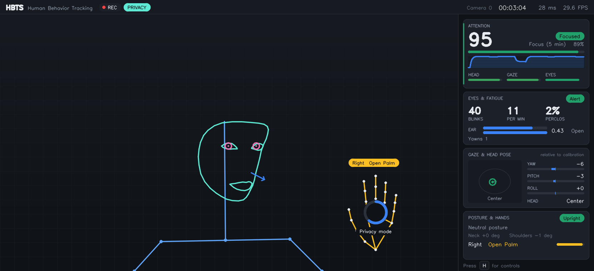
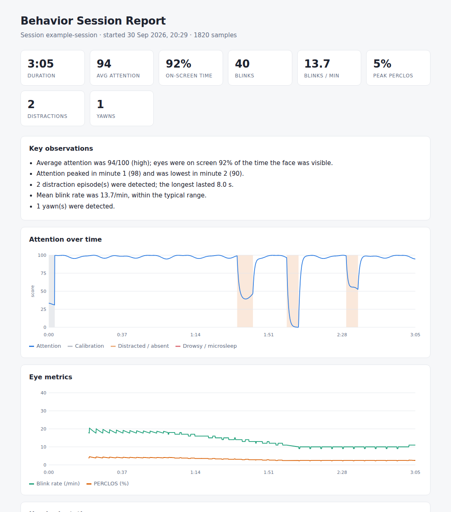

# Human Behavior Tracking System

Real-time, multi-modal behaviour analysis from an ordinary webcam. HBTS
combines face, eye, hand and body tracking into interpretable signals
(attention, fatigue, posture, gestures), shows them on a live dashboard, and
writes every session to disk with an automatically generated report.

Built with Python, OpenCV and the MediaPipe Tasks API.

[](https://github.com/YashasRajR/human-behavior-tracking-system/actions/workflows/ci.yml)



*Live dashboard in privacy mode: the camera image is replaced by a wireframe. The ring around the hand shows a gesture command being held.*

## Highlights

- **Attention score (0-100) with eye-head coordination.** Head pose and iris
  position are fused so that turning your head while your eyes stay on the
  screen is not counted as a distraction.
- **Per-user calibration.** A 4-second calibration learns your open-eye
  baseline and neutral head pose; every threshold is relative to you, not a
  magic constant.
- **Fatigue monitoring.** Blink detection with hysteresis, blink rate over a
  sliding window, PERCLOS, microsleep and yawn detection.
- **Posture tracking.** Slouching, head tilt and uneven shoulders from the
  pose model, compared against your calibrated posture.
- **Hands-free control.** Hold a gesture to trigger a command (bookmark,
  snapshot, privacy mode, pause recording), with a progress ring for feedback.
- **Privacy mode.** Replaces the camera image with an abstract wireframe; no
  camera pixels reach the screen, snapshots or exported video.
- **Session recording and reports.** 10 Hz JSONL/CSV time series, debounced
  event log, and a self-contained HTML report with charts and plain-language
  observations.
- **Tested.** 80+ unit tests cover the geometry, filters and every analytics
  state machine using recorded landmarks and synthetic signals.

## Quick start

```bash
git clone https://github.com/YashasRajR/human-behavior-tracking-system.git
cd human-behavior-tracking-system
python -m venv .venv
.venv\Scripts\activate          # Windows
# source .venv/bin/activate     # macOS / Linux
pip install -e .

hbts                            # start with the default webcam
```

Model files (about 18 MB in total) download automatically into `models/` on
the first run. Sit naturally and look at the screen for the first four
seconds while the system calibrates.

## Usage

```bash
hbts run --camera 1                        # choose a different webcam
hbts run --video lecture.mp4               # analyse a recorded video
hbts run --video lecture.mp4 --headless    # batch mode, no window
hbts run --privacy                         # start in privacy mode
hbts run --no-pose --no-hands              # face analysis only (faster)
hbts run --save-video out.mp4              # export the rendered dashboard
hbts run --config config/default.yaml --set attention.yaw_tolerance=25
hbts report sessions/20260930-142501       # rebuild a session report
hbts models                                # pre-download model files
```

`python -m hbts` works as well.

### Controls

| Key | Action |
| --- | --- |
| `H` | Show or hide the controls overlay |
| `C` | Recalibrate |
| `M` | Toggle landmark overlay |
| `P` | Toggle privacy mode |
| `R` | Pause or resume recording |
| `B` | Add a bookmark |
| `S` | Save a snapshot |
| `Space` | Pause the video |
| `Q` / `Esc` | Quit and write the report |

| Gesture (hold 1.2 s) | Action |
| --- | --- |
| Thumb up | Bookmark |
| Victory | Snapshot |
| Open palm | Toggle privacy mode |
| Closed fist | Pause or resume recording |

Gesture bindings are configurable under `commands.bindings`.

## Session output

Each run creates a folder under `sessions/`:

```
sessions/20260930-142501/
  metrics.jsonl   metrics.csv   events.jsonl   summary.json   config.json
  report.html     snapshots/
```


*Top of a generated report (from a synthetic test session).*

## How it works

```
Camera ─> MediaPipe Tasks (face, hands, pose) ─> feature extraction
      ─> calibration, blink / PERCLOS / yawn, attention, posture, events
      ─> dashboard + session recorder ─> HTML report
```

| Signal | Method |
| --- | --- |
| Eye openness | Eye Aspect Ratio (Soukupova and Cech, 2016), both eyes |
| Blinks | Hysteresis on EAR relative to personal baseline, 50-500 ms duration gate |
| Fatigue | PERCLOS over 60 s, microsleep (> 1 s closure), yawns (sustained MAR) |
| Head pose | Perspective-n-Point on six landmarks with a seeded solver |
| Gaze | Iris position projected onto each eye's own axes |
| Attention | Gaussian falloff on combined head and eye direction, plus eye openness |
| Smoothing | One Euro filter on angles and gaze |

Details and formulas: [docs/methodology.md](docs/methodology.md).
Code structure: [docs/architecture.md](docs/architecture.md).

## Project structure

```
src/hbts/
  core/        geometry, filters, landmark tables, data types
  vision/      MediaPipe face, hand and pose analyzers
  analytics/   blink, fatigue, calibration, attention, events, commands, engine
  io/          video source, model assets, recorder, HTML report
  ui/          theme, drawing primitives, overlays, dashboard layout
  app.py       main loop
  cli.py       command-line interface
tests/         unit tests and landmark fixtures
config/        example configuration
docs/          methodology and architecture
```

## Development

```bash
pip install -e ".[dev]"
pytest -q
ruff check src tests
```

## Changes from the first version

The original prototype consisted of separate eye, head-pose and hand scripts.
This version:

- migrates from the removed `mediapipe.solutions` API to the MediaPipe Tasks API,
- merges all modules into one pipeline with a shared timeline,
- fixes head-pose angles (the prototype scaled `RQDecomp3x3` output by 360 and used pixel coordinates as the 3-D model),
- replaces fixed thresholds with calibrated, hysteresis-based detection,
- replaces per-frame JSON rewrites and Excel re-opening with a non-blocking recorder,
- adds attention, fatigue, posture, events, gesture commands, privacy mode, reports and tests.

## Limitations

HBTS estimates behaviour from visible cues. Gaze direction is approximate, not
a calibrated eye tracker, and fatigue indicators are not a medical or
safety-certified assessment. Performance depends on lighting and camera
placement.

## License

MIT. See [LICENSE](LICENSE).
